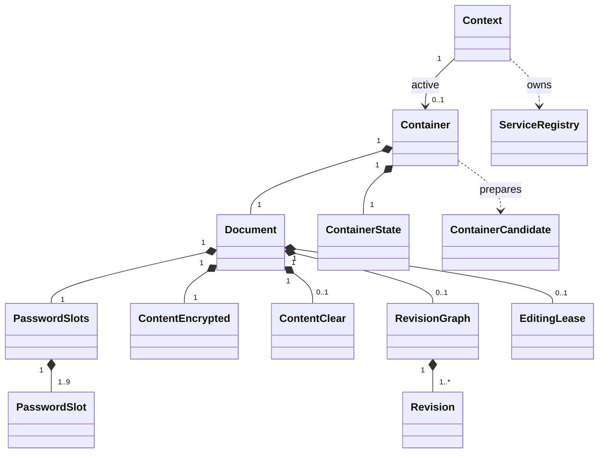

<!-- SPDX-License-Identifier: CC-BY-4.0 -->

# RefactorLibraryToCleanerClasses

Status: proposed C++ library architecture. This document specifies the desired
internal model and observable behavior, not a sequence for changing the current
code. The [product specification](SPECIFICATION.md) defines user behavior, the
[domain model](DOMAIN_MODEL.md) defines terminology, and the
[current architecture guide](CPP_LIBRARY_ARCHITECTURE.md) describes the code as
it exists today.

## 1. Scope and decisions

`libscpefe` is an object-oriented C++20 library with a versioned C ABI. A
`Container` is one loaded `.scpefe` representation. It owns a `Document`, the
logical document state represented by that container. Replicas with the same
document ID can temporarily produce separate in-memory `Container` and
`Document` instances for comparison; the application has one active container
per `scpefe_context`. Object identity is not document identity.

The replacement C ABI uses a long-lived opaque container handle. It need not
preserve the current byte-in/byte-out C ABI, but must preserve its relevant
user-visible capabilities and error distinctions. Unreleased version-1 and
version-2 container reading and version-2 migration are excluded. The only
pre-release reader and writer is container version 3. Its grammar may be
revised before the first release without incrementing the version number;
after a format is released, later releases must continue to read it.

The target path or host handle, app-private journal, publication transaction,
and live editor working copy remain outside `Container`. This document
requires internal seams that can accommodate the additional product behavior
in the product specification without making those external objects duplicate
the C++ document's committed state. No hidden worker thread or event loop is
introduced.

## 2. Ownership and lifecycle

| Class | Owned state and invariant |
| --- | --- |
| `Container` | One open file image, one `Document`, one current `ContainerState`, the authenticated committed image/head, and at most one in-flight publication operation. The same instance survives Open, Lock, Unlock, saves, and target acknowledgements until Close. It does not own a target path. The committed image is distinct from uncommitted text submitted to its `Document`. |
| `Document` | One permanent document ID once authenticated; `PasswordSlots`, `ContentEncrypted`, optional `ContentClear`, optional `RevisionGraph`, `EditingLease`, and authenticated owner/document metadata. A newly opened locked document may have only opaque encrypted fields populated. |
| `PasswordSlots` / `PasswordSlot` | Ordered owner, ordinary, and optional recovery slots; public envelope/KDF fields and opaque wrappers are available on Open. Protected slot data becomes available only as permitted after Unlock. Collection and slot invariants live here; matching and password assessment use the injected `PasswordService`. Other slot passwords are never needed to unlock one slot. |
| `ContentEncrypted` | The authenticated encrypted payload and its format framing. It remains available while the screen is locked. |
| `ContentClear` | Materialized clear text. It changes as soon as the UI submits edited text to the library, including before publication succeeds. The frontend owns unsubmitted edits and undo state. The container separately remembers the last confirmed image/head; submitted text does not become committed merely by entering `ContentClear`. |
| `RevisionGraph` / `Revision` | One canonical reconstructable content lineage, one resolved head, immutable revision IDs and metadata, checkpoints, and metadata-only foreign or pruned records. It validates links and body availability. |
| `EditingLease` | Authenticated shared advisory lease fields. It is never called a screen lock. |
| `ContainerState` | Immutable access, effective permissions, edit/lease mode, conflict, and publication-operation phase. It may represent intermediate states such as a published backup attempt followed by a pending host action. It does not duplicate the frontend working copy's live dirty flag. |
| `ContainerCandidate` | A short-lived proposed document state and exact serialized bytes, with its source head and operation ID. The host owns its publication lifetime. It is never treated as committed merely because serialization succeeded. |

Open parses and validates the envelope and populates opaque slots and
`ContentEncrypted`. Unlock uses a password against the current wrapper,
authenticates the payload, and populates `ContentClear`, `RevisionGraph`, lease,
and slot metadata. Screen Lock denies new C ABI access to clear content and
requires a valid password before access resumes. The UI hides and drops its
display/working-copy projection. The library may retain clear content and
decrypted keys until Close; Lock is a screen-privacy control, not a memory
secrecy claim. Password input need not be retained after authentication.
Ordinary RAII values may hold plaintext and metadata. A small secret-owning
type best-effort clears passwords and keys on destruction/replacement; guarded
memory and pervasive per-field plaintext wiping are not required. Disk
encryption, authenticated parsing, password policy, and diagnostic redaction
remain mandatory.

## 3. Services and dependency construction

A per-context `ServiceRegistry` and composition factory construct the object
graph. The production application creates one context and one active
container. Each constructor declares and retains only the interfaces it uses;
the factory injects those references directly, including into nested classes.
`Container` is not a relay for every service. Tests provide per-context fakes
without changing process-global services. Services own no document state.

| Module | Interface responsibility |
| --- | --- |
| `PasswordService` | Assess new passwords; match an input against the slot order; detect reuse; derive wrapping keys via `EncryptionService`; create and rotate wrappers. `PasswordSlots` and `PasswordSlot` invoke it while owning their own state and policy invariants. |
| `EncryptionService` | All encryption and decryption mechanisms: Argon2id, purpose-separated keys, XChaCha20-Poly1305, secure random values, nonces, authenticated hashes, and verification. It does not decide permissions or revision lineage. |
| `PersistenceService` | Strict, bounded version-3 envelope/CBOR parsing and deterministic serialization of a candidate. Version-specific codec code stays behind this interface. It handles bytes, not target reads, writes, or publication. |
| `HistoryService` | Construct text deltas, reconstruct from checkpoints, choose compaction cutoffs, compute readable comparisons, and prepare three-way merge drafts from available base/local/observed texts. `RevisionGraph` owns and validates the resulting history state. |
| `ContainerStateManagerService` | Given a state, attempted transition, and authenticated facts, return a new state plus typed required effects. It performs no I/O or UI work. |

The factory may install state observers through a narrow interface during
construction. After `Container` atomically installs a new state, observers
receive `(oldState, newState, operationId)` synchronously. They may update
their own projections. Required publication, journal, and security actions
must be represented by the transition result, not depend on an observer
running. Subscriptions end with the container. Durable document revisions are
created only by explicit document operations, not automatically by a state
notification.

## 4. Container state and publication

`ContainerState` distinguishes closed/open, screen locked/unlocked, active
slot/effective permissions, read-only/edit mode, advisory lease status,
unresolved attention, and one publication phase. A state-changing operation
has an operation ID; stale acknowledgements are rejected. Read-only queries
are allowed while an operation is in flight when the screen is unlocked and
the queried data is available. Mutations are serialized.

A content submission updates `Document::ContentClear` immediately. A content
or metadata operation builds a `ContainerCandidate` from the last confirmed
image/head plus the submitted inputs without changing that committed image.
`PersistenceService` serializes it exactly once. The host rereads and
authenticates the target as required, records the exact bytes and transaction
in the app-private journal when needed, and publishes them. On verified
success, the same `Container` adopts the candidate's committed image/head;
its clear text remains the latest submitted text if newer edits arrived in
the meantime. It then notifies state observers. On a definite
failure, the candidate may be destroyed and a later operation may prepare
another one from still-available UI/journal work. On ambiguous publication,
the host resolves or recovers the exact journaled candidate before preparing
a replacement. A candidate never proves target success by itself.

The frontend remains authoritative for live text and dirty state. A save
result identifies the submitted edit revision. If the user typed after that
submission, a later publication success does not make the newer working copy
clean.

## 5. Revision and history model

Version 3 is revised before release to store a baseline snapshot, attributed
delta revisions, occasional full checkpoints, event-only revisions, and
metadata-only records. All semantic history and identity metadata is
encrypted. A valid saved container has at least one baseline `Revision`; it
may have zero deltas after that base. The latest revision may be an event that
leaves text unchanged. `RevisionGraph` exposes both the latest head and the
latest content revision.

Each revision records an immutable ID, content-parent ID where applicable,
event/merge-source links, kind, content hash or body digest, timestamp, actor
slot ID, actor name and email captured at the time, client profile and device,
and the available body kind (`snapshot`, `delta`, `event only`, or `pruned`).
Attribution is self-asserted, not a verified identity. Passwords, document
keys, wrapping keys, and old/new password values are never history details.
Event details may identify the affected slot and relevant permission or
identity change. Revision IDs and parent/merge links must remain stable when
bodies are pruned or moved to checkpoints. The [v3 format specification](format/password-container-v3.md) defines
canonical identity hashing and retains authenticated metadata needed to verify
links after pruning.

The canonical content line is reconstructable from the nearest retained
checkpoint and subsequent deltas. A stored delta is a reconstruction record;
`HistoryService` computes human-readable comparisons from reconstructed
versions. A merge revision's delta is relative to its canonical local content
parent. It records the foreign head(s) it resolved separately. The foreign
graph is held temporarily while resolving; after publication, foreign
revisions are imported as metadata-only records with original IDs and
attribution, linked to the merge revision by `resolvedBy`. They do not form
a second reconstructable content line. The history UI may sort these records
by time and visually distinguish them; ordering by timestamp is presentation,
while IDs and links establish lineage.

If the target changed password slots or permissions, its authenticated
credential and lease state governs the merge. Once an observed target is
authenticated as the same document and passes lineage/head-witness checks,
its permissions become an immediate effective-access overlay. The local
committed bytes do not change until a verified publication or explicit target
replacement. A removed or demoted local slot loses edit/publication authority
immediately; unsaved text remains in the encrypted local journal. A changed
wrapper for the same slot requires authentication with the target's current
password before further privileged operations. Conflicting local slot changes
are retained as local history and a reconciliation event records that target
state prevailed. An unrelated or rolled-back target is surfaced for a user
decision, not silently adopted.

Regular saves create or amend the single provisional content revision based
on the last sealed content state. Manual save seals it without an extra
content node. Discard restores the validated sealed base. An event-only
revision requires a provisional revision to be sealed or explicitly
discarded first; a combined seal-and-event operation may offer one workflow.
Identity-only changes permitted to a view-only slot remain possible without
granting content edit permission.

Compaction defaults to retaining `N=10` reconstructable content delta
revisions after a new base; `N=0` makes the latest content revision the base.
It materializes a full checkpoint at the cutoff revision's existing ID,
removes earlier snapshot/delta bodies, keeps all older revision IDs, links,
actor metadata, and times, and appends an event-only compaction revision.
Thus compaction bounds content-history storage but not metadata growth. It
requires a clean sealed state, full administration, a matching lease, an
explicit decision, and a verified exact pre-compaction backup. If a later
merge base has been pruned, the library reports its text unavailable. A
verified backup or local journal may supply it; otherwise the UI offers
manual two-version comparison without claiming a three-way merge.

## 6. Shared events and external actions

The graph records content saves, merge resolutions, credential and permission
changes, identity reconciliation, compaction, and later stable-format
migration as shared revisions. Backup and plaintext export are also recorded
by conforming clients. Editing-lease heartbeat updates do not create
revisions; screen Lock/Unlock does not create revisions. The log is a
cooperative record of this application's observed actions, not proof that all
copies or exports were made through it.

Backup and export use an attempt/outcome sequence:

1. Authorize and publish an `attempted` event in the source container. If it
   cannot be published, the external action does not start.
2. Perform the backup or plaintext export through the host. A backup is a
   verified byte-for-byte copy of the source after the attempt event; it
   contains that event.
3. Publish a `succeeded` or `failed` event in the source. The source then
   advances beyond a successful backup, which becomes a valid older replica.
   If outcome publication is unavailable, the host journals the pending
   outcome and presents that status until it can reconcile it.

View-only slots have narrow authority to append these activity events
without content-edit permission or an editing lease. The host must reread
the target and reject or reconcile a changed head before publication. This
authority does not grant content revisions or credential administration.
Failure to record the attempt blocks the backup/export, but the cooperative
history cannot guarantee that an already performed action has a published
outcome in every failure mode.

## 7. Replacement C ABI

The ABI version increases because its ownership model changes. The public
handle is an opaque `scpefe_container` created through an explicit
`scpefe_context`; at most one handle is active in a context. Temporary
comparison containers are allowed for authenticated merge/replacement checks
and do not become active. Nested `Document`, slot, revision, and service
classes are private C++ types. C entry points validate spans and structure
versions, delegate to the corresponding C++ operation, and translate errors;
they do not implement policy themselves.

The ABI must cover:

- context health, creation/close of a new or loaded container, screen
  Lock/Unlock, authenticated access and permissions, slot listing and slot
  operations, lease read/update, and work-journal-key derivation;
- manual save, regular save, provisional discard, merge resolution,
  compaction, and candidate preparation/adoption with operation IDs;
- activity attempt/outcome revisions for backup/export and the required
  target-publication effects;
- paged newest-first revision listing with actor slot ID/name/email,
  timestamp, device, kind, source/merge links, and body-availability flags;
  full revision metadata/delta/checkpoint access, reconstruction and
  comparison for available content;
- bounded deterministic revision encode/decode, diagnostic JSON with content
  excluded by default, password-policy assessment, and structured error
  statuses at least as expressive as the current ABI.

Returned snapshots are owned result handles or copied into caller buffers;
no C pointer may borrow mutable internal content across a transition or
Close. Clear-content reads are denied while screen locked. The frontend must
hide and release its own previously obtained display copy on Lock. Revision
queries report a distinct unavailable-body result for pruned or foreign
metadata-only records. Allocation limits, canonical UTF-8/LF text, strict
deterministic CBOR validation, unknown-feature handling, and redaction rules
remain part of the interface contract. The pure revision-format subset must
remain usable by the secondary WebAssembly build.

## 8. Required behavior coverage

| Existing C++ capability | New owner |
| --- | --- |
| Create, open, unlock, and authenticated v3 envelope handling | `Container`, `Document`, `PasswordSlots`, `PasswordService`, `EncryptionService`, `PersistenceService` |
| Password policy; owner/recovery/invitation limits; add, claim, change, reconcile, permission update, and removal | `PasswordSlots`/`PasswordSlot` invariants with `PasswordService` and `EncryptionService` |
| Manual and provisional saves, discard, merge lineage, and content hashes | `RevisionGraph` with `HistoryService`; `Container` prepares/adopts candidates |
| Full-admin compaction and matching-lease check | `RevisionGraph`, `HistoryService`, `EditingLease`, `ContainerStateManagerService` |
| Authenticated lease replacement without a content revision | `EditingLease`, `Container`, `EncryptionService`, `PersistenceService` |
| Deterministic revision CBOR, strict limits, diagnostic JSON, and ABI error translation | `PersistenceService`, format utilities, thin `_abi.cpp` adapters |
| Current v1/v2 readers and v2 migration | Deliberately excluded because those formats are unreleased; future released-format migration uses the same aggregate and candidate seams |

The reimplementation must preserve the current cryptographic baseline,
password-slot permissions and cooperative-policy limits, self-contained
container property, semantic error distinctions, and relevant format
conformance tests. New tests must cover the stateful handle lifetime,
authentication after Lock, candidate acknowledgement and stale operation
IDs, history reconstruction and pruning, metadata-only foreign merges,
target-permission overlay, view-only activity authority, and two-phase
backup/export logging. Exact v3 field numbers, envelope offsets, and CDDL
must be specified in the version-3 format documentation before implementing
the revised writer; this architecture spec defines their required semantics.
